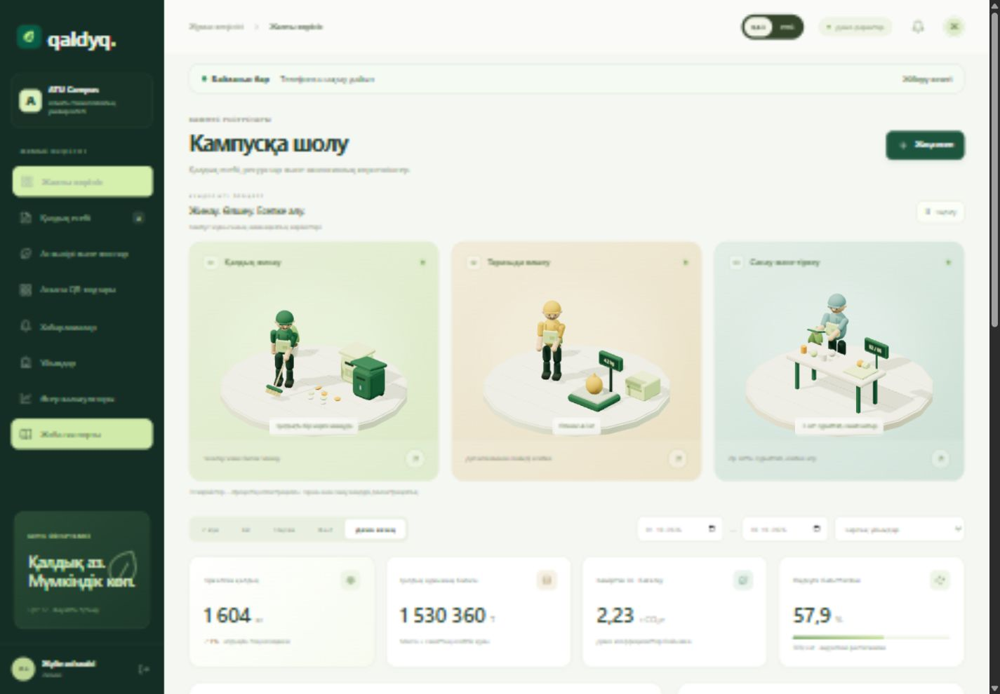

# Qaldyq

ATU кампусындағы тамақ қалдықтарын тіркеу, тексеру және талдау жүйесі. Smart Food Industries хакатонының 1-трегіне арналған жұмыс істейтін жергілікті прототип.

**Команда: NOVA · 3 қатысушы.** Интерфейс қазақша және орысша жұмыс істейді.



## Іске қосу

Python 3.12 немесе одан жаңа нұсқа жеткілікті. Қосымша пакеттер, Node, сыртқы API және интернет қажет емес.

```bash
python server.py
```

Windows-та `./start.ps1` да жарайды. Браузерде [http://127.0.0.1:8765](http://127.0.0.1:8765) ашыңыз. Порт бос болмаса, `server.py --port 8766` қолданыңыз.

Басқа ортада: `python server.py`. Серверді тоқтату: `Ctrl+C`.

## Демо аккаунттар

Барлық аккаунттың құпиясөзі — `demo2026`. Кіру бетінде рөлді таңдағанда email автоматты толтырылады.

| Рөл | Email | Құқықтары |
| --- | --- | --- |
| Қызметкер | operator@atu.kz | Тек «1, 2-корпус асхана кешені (ЖК «Искандер»)» есебін жасау, түзету, жіберу; өз тізіміне жаңа қалдық түрін қосу |
| Қызметкер | inn@atu.kz · coffee@atu.kz · tpp@atu.kz · thipp@atu.kz | ATU INN, АТУ кофеханасы, ТПП және ТХиПП кафедраларының жауаптылары |
| Тексеруші | reviewer@atu.kz | Барлық ұйымның жіберілген есебін тексеруге алу, қабылдау немесе қайтару |
| Басшылық | manager@atu.kz | Есептер, аналитика, экспорт, әсер сценарийі; өзгерту құқығы жоқ |
| Әкімші | admin@atu.kz | Ұйымдар мен санаттарды қосу, барлық ұйымның есеп процесі |

Рөлді ауыстыру үшін сол жақтағы профиль жанындағы шығу батырмасын басыңыз. Демо рөлді ауыстыру үшін де серверде аккаунтқа кіру керек; браузердегі рөл атауын өзгерту құқық бермейді.

## Телефоннан ашу

Ноутбук пен телефон бір Wi-Fi желісінде болса:

```bash
python server.py --host 0.0.0.0
```

Телефон браузерінде `http://<ноутбуктің IP мекенжайы>:8765` ашыңыз. Есеп формасы қарапайым HTTP арқылы да жұмыс істейді. Интернетсіз режим (Service Worker) тек HTTPS немесе localhost-та қосылады.

## Жұмыс процесі

1. Қызметкер «Жаңа есеп» батырмасын басып, күнді, қалдық түрлерін, килограмды, бағытты және қажет болса фотоны енгізеді.
2. «Сақтау / жіберу» алдында «Черновикке сақтау» немесе «Тексеруге жіберу» тәсілін таңдайды. Черновикті кейін де тексеруге жіберуге болады.
3. Тексеруші «Тексеруді күтуде» сүзгісінен есепті ашып, «Тексеруге алу» батырмасын басады.
4. Есеп қабылданады немесе міндетті түсіндірмемен қайтарылады. Қызметкер қайтарылған есепті түзетіп, қайта жібереді.
5. Дашбордқа тек қабылданған есептер кіреді. Барлық әрекеттің уақыты, орындаушысы және пікірі тарихқа сақталады.

Қабылданған есеп өзгертілмейді. Бір есепті екі терезеден өзгерту кезінде ескірген нұсқа `409` қатесімен тоқтатылады. Мәртебе ауысуы сервер транзакциясында орындалады.

## Тіл таңдау · v5

Кіру бетінде, жоғарғы панельде және есеп терезесінде суретке сай «ҚАЗ / РУС» ауыстырғышы бар. Интерфейс, мәзір, форма белгілері, талдау, анимация түсіндірмелері және негізгі хабарламалар ауысады. Таңдау осы браузерде сақталады. Ауыстырғанда формадағы мәндер, енгізілген ескертпе және есеп деректері өзгермейді. Анықтамалықтағы асхана және кафедра атаулары кестеде, сүзгіде, формада және есеп тақырыбында таңдалған тілде көрсетіледі. Іздеу қазақша және орысша атауларды қабылдайды. Базадағы бастапқы атаулар, ұйым ID-лері және пайдаланушының ескертпелері өзгермейді.

`static/i18n.js` — жергілікті сөздік, динамикалық мәндер және тіл таңдауы. `static/i18n.css` — ауыстырғыш стилі. Жаңа тіркестер осы сөздікке қосылады; автоматты аударма қызметіне дерек жіберілмейді.

## Жаңа мүмкіндіктер · v4

- Әр асхананың QR-коды, өз формасын ашу және SVG жүктеу.
- Интернетсіз форма, фото және тұрақты жіберу кезегі; қайта қосылғанда синхрондау.
- Порция саны және кг / 100 порция көрсеткіші, дерек қамтылуы.
- Тағам мен апта күні бойынша артық қалдық талдауы.
- Қабылданған тарихтан келесі күнге порция ұсынысы, әдісі мен үлгі көлемі ашық.
- Айлық мерзім, әр қызметкердің жеке ескертуі, браузер хабарламасы.

Қолдану, формула, телефонға арналған HTTPS және хабарлама жеткізу шектеулері: [FEATURES.md](docs/FEATURES.md).

## v5.4 · ТЗ талаптарына сәйкестендіру

- Ұйымдар мен қалдық түрлері «АТУ университет кешеніндегі тамақ қалдықтарын есепке алу кестесі» үлгілері бойынша; әр ұйымның өз тізімі.
- Қалдық түрінде өлшем бірлігі (кг / л), «қайта өңдеуге жарамды» белгісі және әдепкі кәдеге жарату тәсілі бар. Литрмен өлшенетін қалдық килограмм жиынтығына қосылмайды, бөлек көрсетіледі.
- Кәдеге жарату тәсілдері — анықтамалық: ТҚҚ шығару, ТҚҚ шығару (қоқыс жәшігі), қайта өңдеу, компосттау, жоюға жіберу.
- Жауапты қызметкер формадан шықпай өз ұйымының тізіміне жаңа қалдық түрін қосады.
- Формада әр қалдық түрінің күндік және айлық жиынтығы бірден есептеледі; сол күнге есеп бар болса, ескерту шығады.
- Тізілімде қалдық түрі бойынша сүзгі; дашбордта үшінші диаграмма — ұйымдарды салыстыру; қайта өңдеуге жарамды үлес қалдық түрінің белгісі бойынша.
- Бастапқы кезең — ағымдағы тоқсан.

Әлі жасалмағаны: айлық есепті бір әрекетпен жіберу (қазір есеп — бір күн), пайдаланушыларды интерфейстен тіркеу, қалдық түрін өшіру орнына деактивациялау, Excel импорты, Telegram-бот, OCR, таразы API-і.

## Мүмкіндіктер

- Қазақша, телефонға бейімделген интерфейс.
- Жаңартылған қою жасыл мәзір, үш қозғалатын 3D кейіпкер: қалдық жинау, таразыда өлшеу және заттарды санау. Кіру экранында 3D кампус иллюстрациясы бар.
- Нақты деректен жасалатын көлемді бағандық және сақиналы диаграммалар; tooltip және мәндер кестесі.
- Анимацияны тоқтату/жалғастыру, қозғалысты азайту баптауы және WebGL жоқ ортаға қосалқы рендер.
- Ұйым, күн және кезең бойынша сүзгілер; іздеу және беттеу.
- Бір есепке бірнеше қалдық түрі; мәндердің клиентте және серверде тексерілуі.
- JPEG, PNG, WebP фото, ең көбі 2 МБ; фото міндетті емес.
- Бес мәртебе, рөлдер, қайтару пікірі және өзгерістер тарихы.
- Қабылданған есептердің массасы, құны, CO₂e бағасы, құрамы мен динамикасы.
- Есеп тапсырмаған ұйымдар және тексеруді күткен есептер; келесі айдың 5-і туралы интерфейстегі ескерту. Бұл мерзім — прототиптің ұсынылған ішкі тәртібі, хакатонның ресми талабы емес. SMS/email жіберілмейді.
- Есеп егжей-тегжейінде ауытқуды белгілеу: сол ұйымның таңдалған кезеңдегі кемінде 5 қабылданған есебі бар және масса олардың медианасынан 2 еседен жоғары. Бұл AI емес.
- CSV және Excel оқитын SpreadsheetML `.xls` экспорты; браузердің басып шығару терезесі арқылы PDF сақтау. XLS — XLSX емес: кейбір Excel нұсқалары XML мазмұны мен `.xls` кеңейтімінің сәйкестігі туралы ескерту бере алады.
- CAPEX, OPEX, қалдықты азайту гипотезасы бойынша таза үнем, CO₂e және өтелу сценарийі.
- Әкімші үшін ұйымдар мен қалдық санаттарын қосу.
- Жоба паспорты: критерийлермен сәйкестік, демо, пилот және шектеулер.

CSV және Excel экспортына таңдалған кезең, ұйым және қалдық түрі бойынша тек қабылданған жазбалар кіреді. Excel файлында екі парақ бар: «Жиынтық» (ұйым × қалдық түрі) және «Тізілім» (күні, қалдық түрі, саны, бірлігі, кәдеге жарату тәсілі, жауапты тұлға). Браузер арқылы басылатын PDF тізімі барлық мәртебені көрсетеді. Excel формуласына айналуы мүмкін мәтіндік өрістер қорғалған.

## Деректер мен әдіс

Алғашқы іске қосқанда ТЗ үлгілеріндегі бес ұйым, сегіз аккаунт, 19 қалдық түрі (әр ұйымның өз тізімі), бес кәдеге жарату тәсілі және 2026 жылғы 1 тамыз – 30 қазан аралығындағы синтетикалық есептер жасалады. Кафедралар тек зертханалық сабақ күндері есеп береді. Бұрынғы нұсқаның базасы (`data/qaldyq.sqlite3`) ескі ұйымдарды сақтайды; жаңа демо дерек үшін сол файлды өшіріп, серверді қайта іске қосыңыз. Демоның есептік күні — 2026-10-30. Әртүрлі кезеңдерді, соның ішінде жылды, таңдағанда жүктелген демо деректер ғана есептеледі; толық жылға нақты дерек бар деп көрсетілмейді.

Барлық жазба `data/qaldyq.sqlite3` файлында сақталады. Қайта іске қосқанда пайдаланушы жасаған есептер сақталады. Демо аккаунттар қайтадан жасалмайды. Бөлек таза база керек болса:

```bash
python server.py --port 8766 --db data/separate-demo.sqlite3
```

Есептегі құн мен CO₂ коэффициенттері санаттан көшіріліп, сол есепте сақталады. Кейін анықтамалық өзгерсе, бұрынғы есептің бағасы өзгермейді.

- Құн бағасы = масса × санаттың демо құны.
- Көміртек ізі бағасы = масса × санаттың демо коэффициенті.
- Өңдеуге бағытталған үлес = компосттау/қайта өңдеу бағытымен тіркелген масса ÷ қабылданған масса. Бұл нақты өңделген қалдықтың расталған үлесі емес.
- Алдыңғы кезең — таңдалған кезеңнің алдында тұрған дәл сондай күн саны. База жоқ болса, салыстыру пайызы көрсетілмейді.
- Калькулятор: айлық болдырылмаған масса = айлық база × азаю пайызы; таза үнем = сол масса × құн − OPEX; өтелу = CAPEX ÷ таза үнем. Таза үнем оң болмаса, «Өтелмейді» көрсетіледі.
- Кезеңнен айлық база алу: масса ÷ кезеңдегі күн саны × 30; құн және CO₂ коэффициенттері — массамен өлшенген орташа мәндер.

Сценарийлер нақты үнем туралы мәлімдеме емес. Пилотта бағалар мен эмиссия коэффициенттерінің дереккөздері, есеп шекарасы және белгісіздігі тіркелуге тиіс. Бұл прототип тағамды қайта пайдалануға немесе таратуға рұқсат бермейді.

## Құрылымы

```text
server.py               HTTP API, авторизация, SQLite, экспорт
features.py             Порция, тағам ұсынысы, миграция, мерзім ескертуі
static/features.js      QR, жоспар, хабарламалар, жергілікті форма
static/offline-store.js  IndexedDB, пайдаланушы кезегі және синхрондау
static/sw.js            Интернетсіз ашу және фондық синхрондау
static/index.html       Қосымшаның кіру нүктесі
static/app.js           Интерфейс және интерактивті сценарийлер
static/styles.css       Десктоп, телефон және басып шығару стильдері
static/studio.css       Жаңа дизайн, 3D кадрлар және параллакс стильдері
static/animations.js    3D кейіпкерлер, анимациялар және көлемді диаграммалар
static/animations.css   Анимация бөлімдері мен диаграмма стильдері
static/vendor/          Жергілікті Three.js 0.186.1 және MIT лицензиясы
static/*-3d-v2.png       Жобаға енгізілген екі 3D иллюстрация
tests/test_server.py    Оқшау HTTP + SQLite интеграциялық тесттері
docs/PITCH.md           10 слайдқа арналған мазмұн және 5 минуттық қорғау
docs/RESEARCH.md        Бастапқы зерттеу, дереккөздер, аналогтар, пилот
docs/ARCHITECTURE.md    API, қауіпсіздік шекарасы және енгізу жоспары
docs/DESIGN.md          Дизайн, 3D файлдарының жолдары және промпттар
docs/ANIMATIONS.md      Үш кейіпкер, 3D диаграмма, рендер және тексерулер
start.ps1               Windows іске қосу сценарийі
```

## Тексеру

```bash
python -m unittest discover -s tests -v
node --check static/app.js
node --test tests/app.test.cjs tests/offline.test.cjs tests/i18n.test.cjs
```

Тесттер уақытша база мен бос портта жұмыс істейді; негізгі демо деректерін өзгертпейді. Node қосымшаны іске қосуға қажет емес, тек JavaScript синтаксисін тексеруге қолданылады.

## Жергілікті демонстрацияның шекарасы

Парольдер PBKDF2 арқылы хэштеледі; cookie HttpOnly және SameSite=Strict; жазу әрекеттерінде CSRF және рөл тексеріледі. Сессия 8 сағат жарамды және сервер жадында сақталады. Сервер тоқтаса, қайта кіру қажет. Жергілікті HTTP үшін cookie Secure жалаушасы қолданылмайды.

Кампусқа енгізер алдында демо аккаунттарды жеке аккаунттармен ауыстыру, HTTPS, тұрақты сервер, резервтік көшіру, сақтау мерзімі, нақты коэффициенттер және есеп тәртібін келісу қажет. QR және жеке ескертулер бар. Email / SMS / Telegram / жабық браузерге push, таразымен интеграция және ML моделі қосылмаған. Сервер тұрақты іске қосылса, мерзім ескертулері қосымша жабық кезде де базаға жасалады.

## Декларация (регламент 11.3, ТЗ НФТ-5, НФТ-6)

- **Алдын ала әзірлеме.** Прототиптің негізі хакатон күніне дейін жасалды; хакатон күнгі өзгерістер репозиторий тарихында бөлек коммиттермен көрінеді. Мұны менторлар мен қазыларға ашық айту қажет.
- **Генеративті ЖИ.** Код, құжат мәтіндері және екі PNG иллюстрация (`static/campus-3d-v2.png`, `static/cycle-3d-v2.png`) генеративті ЖИ көмегімен дайындалды; иллюстрация промпттары `docs/DESIGN.md` ішінде. Қолданылған ЖИ-құралдардың нақты атауларын команда осы жерге жазады: `<толтыру қажет>`.
- **Ашық кітапханалар.** Three.js 0.186.1 (MIT) және qrcode-generator (MIT); лицензиялары `static/vendor/` ішінде. Сервер — тек Python стандартты кітапханасы.
- **Деректер.** Барлық есеп синтетикалық. Құн мен CO₂ коэффициенттері — команданың жорамалы, дереккөзбен расталмаған.
- **Дереккөздер.** UNEP Food Waste Index 2024, БҰҰ ЦУР 12, Leanpath, Winnow — сілтемелері `docs/RESEARCH.md` ішінде.

Команда — NOVA, 3 қатысушы. Нақты қатысушылардың жұмысы мен рөлдері қорғау материалында өздерімен толтырылады.

Кіру кезінде кезең ағымдағы тоқсанға орнатылады. «7 күн», «Ай», «Тоқсан», «Жыл» бүгінгі күнмен есептеледі. Тамыз–қазандағы синтетикалық деректердің қазан бөлігін «Демо кезең» арқылы ашуға болады.

Ресми міндет пен критерийлер: [Smart Food Industries](https://atu-fit.github.io/SmartFoodIndustries/#tracks).
