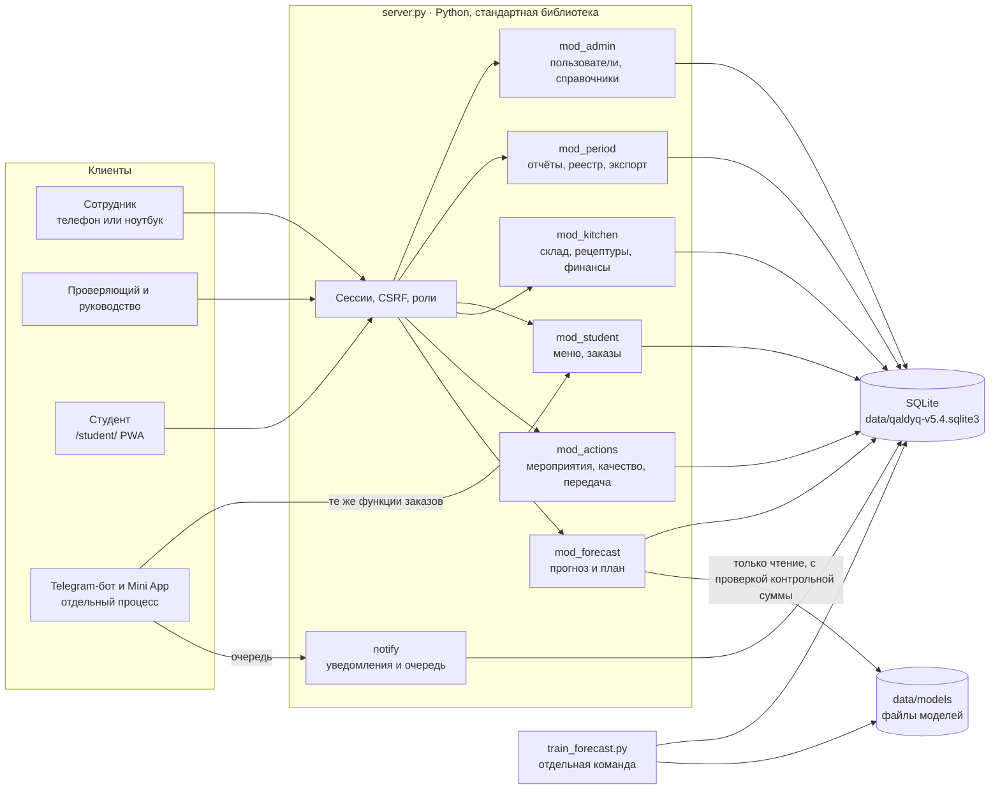
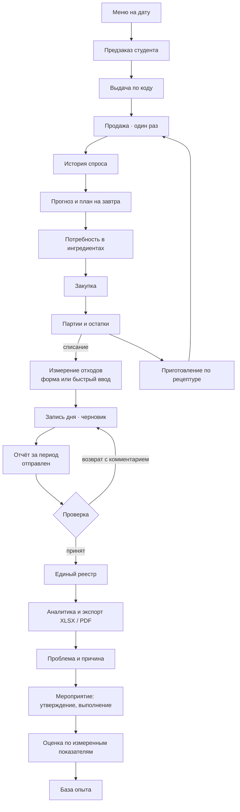

# Архитектура Qaldyq

## Схема системы

Один процесс, одна база. Каждый модуль отвечает за свои таблицы, миграции и права; `server.py` проверяет сессию и CSRF и передаёт запрос модулям. Сайт, Mini App и бот вызывают одни и те же функции заказов, поэтому правила не могут разойтись между каналами.

## Схема работы

## ER-диаграмма

```mermaid
erDiagram
    organizations ||--o{ users : "сотрудники"
    organizations ||--o{ org_categories : "свой перечень"
    categories ||--o{ org_categories : ""
    organizations ||--o{ reports : "записи дня"
    organizations ||--o{ period_reports : "отчёты за период"
    period_reports ||--o{ reports : "объединяет"
    period_reports ||--o{ period_history : "история"
    users ||--o{ reports : "автор"
    reports ||--|{ items : "измерения"
    reports ||--o{ history : "история"
    categories ||--o{ items : "вид отходов"
    routes ||--o{ items : "способ обращения"
    organizations ||--o{ catalog_dishes : "каталог"
    catalog_dishes ||--|{ dish_portions : "варианты порций"
    organizations ||--o{ menu_days : "меню на дату"
    menu_days ||--|{ menu_items : "позиции и лимиты"
    dish_portions ||--o{ menu_items : ""
    users ||--o{ orders : "студент"
    menu_days ||--o{ orders : ""
    orders ||--|{ order_items : "строки с ценой на момент заказа"
    orders ||--o{ order_events : "переходы статусов"
    order_items ||--o| sales : "продажа при выдаче"
    order_items ||--o| dish_reviews : "отзыв"
    organizations ||--o{ sales : ""
    organizations ||--o{ ingredients : ""
    ingredients ||--o{ purchases : ""
    purchases ||--|| stock_batches : "партия"
    ingredients ||--o{ stock_batches : ""
    stock_batches ||--o{ stock_moves : "движения"
    items ||--o| stock_moves : "списание как измерение"
    catalog_dishes ||--o{ recipes : "версии"
    recipes ||--|{ recipe_items : ""
    ingredients ||--o{ recipe_items : ""
    recipes ||--o{ productions : "приготовление"
    organizations ||--o{ expenses : ""
    organizations ||--o{ day_close : "баланс порций"
    organizations ||--o{ shortages : "нехватка"
    organizations ||--o{ handovers : "передача смены"
    organizations ||--o{ actions : "мероприятия"
    actions ||--o{ action_events : "история"
    organizations ||--o{ transfers : "передача на переработку"
    categories ||--o{ transfers : ""
    organizations ||--o{ clarifications : "уточнения"
    catalog_dishes ||--o{ forecasts : ""
    forecasts ||--o| plans : "утверждённый план"
    users ||--o{ user_notices : "уведомления"
    users ||--o{ outbox : "внешняя доставка"
    users ||--o| external_links : "привязка Telegram"

    organizations { int id PK
        text name
        text kind
        text address
        text hours
        int active
        int is_public }
    users { int id PK
        text email
        text role
        int org_id FK
        int can_review
        int active }
    categories { int id PK
        text name
        text unit "kg | l"
        int recyclable
        text default_route FK
        real co2
        text co2_unit
        text source
        text boundary
        int active }
    period_reports { int id PK
        int org_id FK
        text period_start
        text period_end
        text status
        text submitted_at
        int reviewer_id FK
        text decided_at }
    items { int id PK
        int report_id FK
        int category_id FK
        real kg "количество в кг или л"
        text route FK
        text stage
        text note }
    orders { int id PK
        int user_id FK
        int menu_id FK
        text pickup_slot
        text status
        text code
        int total_tiyn
        text payment_status
        text source }
    sales { int id PK
        int org_id FK
        text day
        int qty
        int total_tiyn
        text source
        int order_item_id FK
        text payment_status }
    stock_batches { int id PK
        int ingredient_id FK
        text received_day
        text expiry_day
        text storage
        int qty_milli_left
        text state }
    stock_moves { int id PK
        int batch_id FK
        text kind
        int qty_milli
        int value_tiyn
        int waste_item_id FK }
    actions { int id PK
        int org_id FK
        text status
        text cause
        text cause_source
        text baseline_start
        text control_start
        int cost_tiyn
        int confirmed_savings_tiyn }
    plans { int org_id PK
        text day PK
        int dish_id PK
        int suggested
        int approved
        text reason }
```

## Данные и расчёты

- **Количества.** Измерения отходов хранятся в единице вида (кг или л) и никогда не суммируются между единицами. Складские количества — целые тысячные доли базовой единицы (г, мл).
- **Деньги.** Целые тиыны; ввод проверяется с точностью до тиына.
- **Оценка запасов.** Средневзвешенная стоимость по организации и ингредиенту; при выдаче последней единицы уходит весь остаток стоимости, поэтому округление не накапливается.
- **Порядок использования.** Сначала партия с ближайшим сроком годности (FEFO); просроченные и непригодные партии не используются. Это отдельное правило от финансовой оценки.
- **Управленческий результат.** Продажи − стоимость израсходованных запасов − списания ± корректировки − расходы периода. Оплата закупок показывается отдельно и в результат не входит.
- **Время.** Метки записей — в UTC; правила заказов и сроков считаются по времени кампуса (UTC+5).

## Права доступа

Проверяются на сервере для каждого запроса. Сотрудник ограничен своей организацией независимо от параметров запроса. Роль student по умолчанию закрыта от всех служебных путей: разрешены только `/api/student/`, выход и сведения о себе. Чужой заказ или чужой код выдачи сообщаются как «не найдено».

| Действие | Сотрудник | Проверяющий | Руководство | Администратор | Студент |
| --- | --- | --- | --- | --- | --- |
| Измерения и отправка отчёта своей организации | да | — | — | да | — |
| Принять или вернуть отчёт | — | да | — | только с явным флагом | — |
| Реестр и сводки | своя организация | все | все | все | — |
| Справочники | добавить вид в свой перечень | да | — | да | — |
| Пользователи и организации | — | — | — | да | — |
| Меню, заказы, склад своей столовой | да | — | просмотр | да | — |
| Утвердить мероприятие | — | — | да | да | — |
| Меню, свои заказы, избранное | — | — | — | — | да |

## Офлайн и уведомления

- Формы отчётов, фото и очередь отправки хранятся в IndexedDB и привязаны к пользователю; повторная отправка идёт с тем же ключом запроса, поэтому дубликат не создаётся.
- Студенческое приложение без связи показывает сохранённое меню с временем обновления и без сведений о наличии; выбор сохраняется на устройстве, но порции не резервируются, пока сервер не подтвердит заказ.
- Уведомления трёх видов: внутренние (всегда), браузерные (если пользователь разрешил и приложение открыто) и внешние каналы через очередь `outbox`.

## Развёртывание для пилота

1. Отдельная база без демо-данных: `QALDYQ_DEMO=0`.
2. Личные аккаунты сотрудников, смена паролей.
3. HTTPS и обратный прокси перед встроенным сервером; публичный адрес для телефонов и Mini App.
4. Ежедневная резервная копия файла базы и каталога моделей; проверка восстановления.
5. Согласованные коэффициенты стоимости и CO₂ с источником и границей расчёта.
6. Порядок хранения фото и персональных данных.
