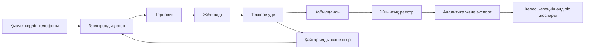
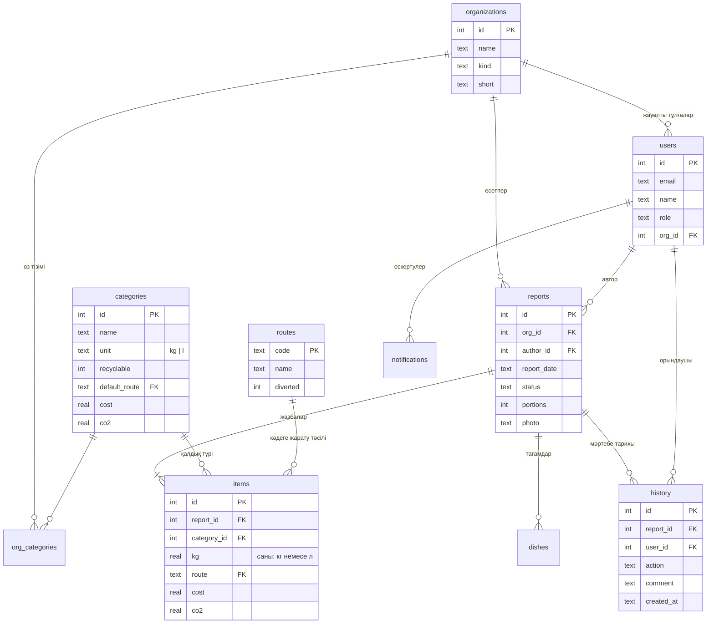

# Qaldyq архитектурасы

## Дерек жолы

Қабылданған есеп өзгермейді. Рөлдер серверде тексеріледі. Клиентке жіберілетін есептер оператордың ұйымымен шектеледі; URL-дегі ұйым параметрі бұл шектеуді айналып өтпейді.

## Деректер моделі

| Кесте | Міндеті |
| --- | --- |
| organizations | Асхана, қонақүй, кофехана және кафедра реестрі |
| users | Аккаунт, рөл, ұйым, salt және PBKDF2 хэш |
| reports | Ұйым, күн, автор, мәртебе, ескертпе және фото |
| items | Қалдық түрі, масса, бағыт және сақталған коэффициенттер |
| history | Әрекет, орындаушы, пікір және UTC уақыт |
| categories | Қалдық түрлері және жаңа есептерге арналған коэффициенттер |
| settings | Әдістемелік түсіндірме |

Фото жергілікті базада data URL ретінде сақталады. Бұл көлемі аз демонстрацияға ыңғайлы; пилотта файл сақтауы, фотоны қайта кодтау, сақтау мерзімі және қолжетімділік журналы қажет. Қазіргі валидация MIME, өлшем және файл сигнатурасын тексереді, толық сурет декодері емес.

## API

| Әдіс және жол | Қолжетімділік |
| --- | --- |
| GET /api/health | Сервердің күйі, ашық |
| POST /api/login | Email және құпиясөз, ашық |
| POST /api/logout | Кірген пайдаланушы және CSRF |
| GET /api/bootstrap | Профиль, ұйымдар, санаттар, CSRF |
| GET /api/reports?start=…&end=…&org=… | Кірген пайдаланушы, операторға өз ұйымы |
| POST /api/reports | Қызметкер және әкімші |
| GET /api/reports/:id | Кірген пайдаланушы, операторға өз ұйымы |
| PUT /api/reports/:id | Қызметкер/әкімші, тек черновик/қайтарылған |
| POST /api/reports/:id/transition | Рөл мен ағымдағы мәртебеге сәйкес |
| GET /api/export?format=csv немесе xls | Кірген пайдаланушы, операторға өз ұйымы |
| POST /api/organizations | Әкімші |
| POST /api/categories | Әкімші |

Өзгерту сұраулары `X-CSRF-Token` тақырыбын талап етеді. Есепті өзгерту мен мәртебесін ауыстыруда алынған `updated_at` мәні жіберіледі. Ескірген нұсқа 409 қайтарады. Жазу транзакциясында `BEGIN IMMEDIATE` параллель мәртебе ауыстыруды реттейді.

## Ауытқу ережесі

Есеп ашылғанда сол ұйымның экранда таңдалған кезеңдегі қабылданған есептері алынады. Салыстыруға ағымдағы есеп кірмейді. Кемінде бес бақылау болса, медиана есептеледі. Ағымдағы масса медианадан екі есе жоғары болса, тексерушіге белгі шығады.

Мұнда жүктеменің, келуші санының немесе ас мәзірінің өзгеруі ескерілмейді. Белгі қателікке дәлел емес; ол тек өлшеуді тексеруге шақырады. Пилотта бірдей қызмет түрі мен порция санына нормалау керек.

## Пилотқа өту

1. Демо базадан бөлек пилот базасын дайындау, ұйымдардың жауаптыларын бекіту.
2. Жеке аккаунттар, пароль ауыстыру және қалпына келтіру тәртібі.
3. HTTPS, өндірістік HTTP сервері немесе reverse proxy, мониторинг.
4. Резервтік көшіру және қалпына келтіруді тәжірибеде тексеру.
5. Есеп мерзімі, қалдық категориялары, таразы тексеруі және фото сақтау тәртібі.
6. Баға мен CO₂ коэффициенттерінің дереккөздері және нұсқалары.
7. QR үшін қолжетімді HTTPS доменін орнату; қажет болса, таразы және email / SMS / Web Push жеткізу қызметін қосу.

Сервер әдепкіде тек `127.0.0.1` адресінде тыңдайды. Телефоннан қолдану үшін университет мақұлдаған қорғалған серверге орналастыру қажет; браузердің localhost адресі басқа телефонға ашылмайды.

## v4 API

| Әдіс | Қолжетімділік |
| --- | --- |
| GET /api/food-insights?start=…&end=…&org=…&target=… | Кірген пайдаланушы; оператор өз ұйымымен шектеледі |
| GET /api/notifications | Тек өз жеке хабарламалары |
| POST /api/notifications/read | Тек өз хабарламасына id арқылы белгі |
| POST /api/reminder-settings | Әкімші; deadline_day 1–28 |

Есеп өрістері: portions (міндетті емес), dishes (0–30 тағам). POST-та submit=true атомдық жіберуді орындайды. POST/PUT request_id кілті бір пайдаланушының бір сұрауын қайталап сақтамайды. Толық архитектура мен шектеулер [FEATURES.md](FEATURES.md) ішінде.

## v5.4 · Деректер моделі (ER)

Күндік және айлық жиынтықтар сақталмайды, жазбалардан есептеледі. Бірыңғай тізілім — «қабылданды» мәртебесіндегі есептердің жазбалары. Қалдық түрін өшіру API-і жоқ.

| Әдіс және жол | Қолжетімділік |
| --- | --- |
| GET /api/reports?…&category=ID | Қалдық түрі бойынша сүзгі: тек сол түрдің жолдары мен жиынтығы |
| GET /api/totals?org=…&date=…&exclude=… | Ұйымның әр қалдық түрі бойынша күндік және айлық жиынтығы; оператор өз ұйымымен шектеледі |
| POST /api/categories | Қызметкер (тек өз ұйымының тізіміне, коэффициентсіз), тексеруші, әкімші |
| GET /api/export?format=csv, xls немесе summary | Тек қабылданған жазбалар; xls ішінде «Жиынтық» және «Тізілім» парақтары |
